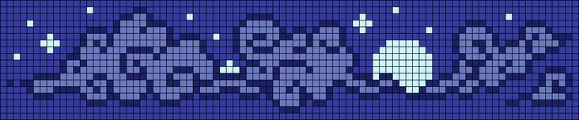

# Muhammad Fikri

**AI/ML Engineering Enthusiast** · Building intelligent systems, one model at a time.

&nbsp;
&nbsp;
&nbsp;
&nbsp;

---

## About Me

- **Role:** ML Engineer Intern in Jakarta, building and deploying classification models in production
- **Result:** ~89% accuracy on heart disease classification (Extra Trees, scikit-learn Pipeline)
- **Project:** OncoVision AI, an end-to-end cancer detection system with a live frontend dashboard
- **Learning:** MLOps: Docker, MLflow, model serving, CI/CD for ML
- **Location:** Indonesia
- **Open to:** collaboration on ML and FastAPI projects

---

## Tech Stack

### Machine Learning & AI

### Backend & Deployment

### Data & Experimentation

---

## Certifications

- [Machine Learning Operations (MLOps) untuk AI Generatif](https://www.skills.google/public_profiles/2e118d63-915a-4028-b667-9e57af719b6f/badges/17281299?qlcampaign=gs) (Google)
- [Innovating with Google Cloud Artificial Intelligence](https://www.skills.google/public_profiles/2e118d63-915a-4028-b667-9e57af719b6f/badges/17007714) (Google)
- [Using the Google Cloud Speech API](https://www.credly.com/badges/52fce0ec-cf77-41a4-9614-483915a5d550/linked_in_profile) (Google)
- [Analyze Speech and Language with Google APIs](https://www.credly.com/badges/7fd1f2cd-1b11-4909-9694-b68690c42a5c/linked_in_profile) (Google)
- [Belajar Dasar Visualisasi Data](https://www.dicoding.com/certificates/ERZREV30QXYV) (Dicoding Indonesia)

---

## GitHub Stats

<picture>
  <source media="(prefers-color-scheme: dark)" srcset="https://streak-stats.demolab.com/?user=fiksdevploper&theme=tokyonight-duo&hide_border=true">
  
</picture>

---

> *"Models don't lie, but data can. Clean it first."*

